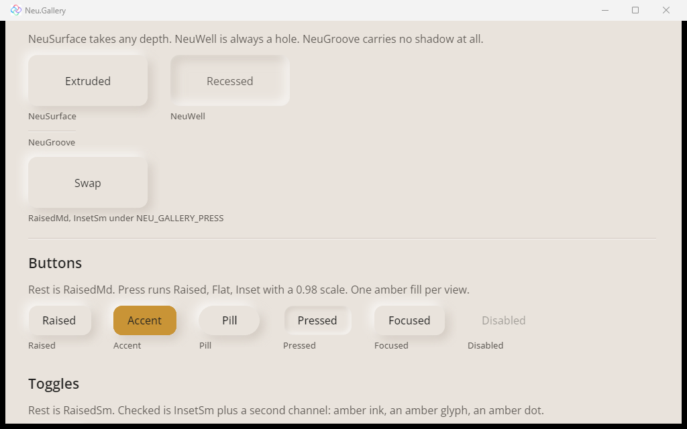
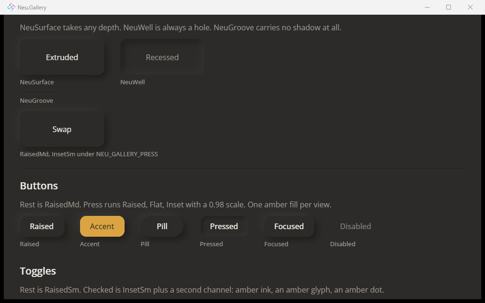
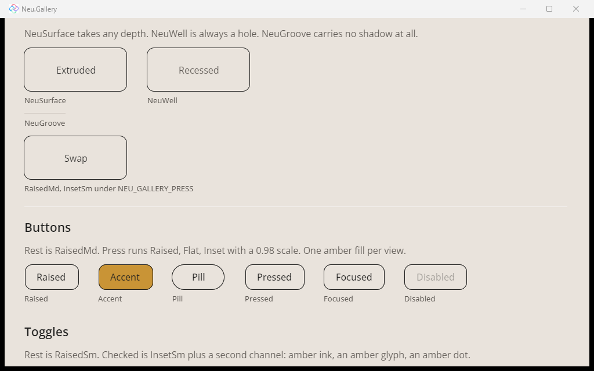

# Neu.Uno

A neumorphism theme for [Uno Platform](https://platform.uno): warm plaster tokens, a
six-step depth scale, and eighteen retemplated WinUI controls. Canvas and control
share one colour; depth carries the meaning.



Everything is drawn by `ShadowContainer` from `Uno.Toolkit.Skia.WinUI`, so every
Skia head renders the same shadows. That is the whole dependency list.

| | |
|---|---|
| Package | `Neu.Uno` (`0.1.0-alpha`, not published yet - reference the project) |
| Targets | `net10.0-desktop`, `net10.0-browserwasm`, `net10.0-android`, `net10.0-ios` |
| Dependency | `Uno.Toolkit.Skia.WinUI`, resolved through `UnoFeatures` |
| Built against | .NET 10, Uno.Sdk 6.7.18 |
| Not supported | WinAppSDK / Windows composition. Skia only, by design |

## Install

```xml
<ItemGroup>
  <ProjectReference Include="..\Neu.Uno\src\Neu.Uno\Neu.Uno.csproj" />
</ItemGroup>
```

Your app needs the Toolkit too, which `UnoFeatures` brings in. `Skia` has to be
there as well as `Toolkit` - `Toolkit;` alone silently omits the package that
carries `ShadowContainer`:

```xml
<UnoFeatures>
  Toolkit;
  Skia;
  SkiaRenderer;
</UnoFeatures>
```

## Use it

Merge `NeuTheme` into `Application.Resources`, last, so it wins:

```xml
<Application x:Class="MyApp.App"
             xmlns="http://schemas.microsoft.com/winfx/2006/xaml/presentation"
             xmlns:x="http://schemas.microsoft.com/winfx/2006/xaml"
             xmlns:neu="using:Neu.Uno">
  <Application.Resources>
    <ResourceDictionary>
      <ResourceDictionary.MergedDictionaries>
        <XamlControlsResources xmlns="using:Microsoft.UI.Xaml.Controls" />
        <ToolkitResources xmlns="using:Uno.Toolkit.UI" />
        <neu:NeuTheme />
      </ResourceDictionary.MergedDictionaries>
    </ResourceDictionary>
  </Application.Resources>
</Application>
```

That changes nothing on its own. Every style is keyed, so you opt in one control
at a time:

```xml
<Button Style="{StaticResource NeuButtonStyle}" Content="Raised" />
```

Or take the lot:

```xml
<neu:NeuTheme UseImplicitStyles="True" />
```

Implicit styles match on the exact type, so a control you derived yourself -
`class MyDialog : ContentDialog` being the usual one - keeps its stock chrome and
still needs the keyed style by hand.

## What is in it

**Controls.** Button (plus Accent and Pill), ToggleButton, CheckBox, RadioButton,
ToggleSwitch, Slider, ProgressBar, ProgressRing, TextBox, PasswordBox, NumberBox,
ComboBox, ListView / ListViewItem, Card, Chip, TabBar, Expander, ContentDialog.

**Primitives.** `NeuSurface` (a slab at any depth), `NeuWell` (always a hole),
`NeuGroove` (a scored divider, the one thing here with no shadow).

**Tokens.** Colours, metrics, radii, spacing and a type ramp, all as
`ThemeResource` keys - see the [override guide](docs/overrides.md) for the full
list and how to restate any of them.

### The depth scale

Six named `ShadowCollection` resources. Templates reference these by name and
never declare a shadow inline, which is what lets a dictionary swap restyle every
control at once.

| Collection | Offset | Blur | Spread | Use |
|---|---|---|---|---|
| `NeuRaisedSm` | 3 | 6 | 0 | list rows, chips, inline inputs |
| `NeuRaisedMd` | 6 | 12 | 0 | buttons, toggles, cards |
| `NeuRaisedLg` | 10 | 24 | -2 | dialogs, floating surfaces |
| `NeuInsetSm` | 3 | 6 | 0 | pressed, checked, fields |
| `NeuInsetMd` | 6 | 12 | 0 | wells, tracks |
| `NeuFlat` | - | - | - | disabled |

Each is exactly two shadows: `NeuShadowDark` at `(+offset, +offset)` first, then
`NeuShadowLight` at `(-offset, -offset)`. Order matters, later overlaps earlier.

### The signature

Every interactive is an extrusion that inverts to an inset when pressed, through a
brief flat midpoint. One signature, applied everywhere; everything else stays
quiet. No strokes, no hover elevation, one amber fill per view.

State is never depth alone. Pressed, checked, selected, focused and error each add
a second channel - a glyph, an ink change, an amber ring, an amber bar - so the
theme still reads when the shadows are gone.

### Dark



Shadow colours are not tinted versions of one pair: the dark theme lifts its
highlight to `#3D3B38` rather than white, because a white highlight on a dark slab
reads as a light source rather than a shape.

### High contrast

Merge one more dictionary and every control loses its depth and gains a 1px ink
outline:

```xml
<ResourceDictionary.MergedDictionaries>
  <neu:NeuTheme />
  <ResourceDictionary Source="ms-appx:///Neu.Uno/Theme/Neu.HighContrast.xaml" />
</ResourceDictionary.MergedDictionaries>
```



It restates the depth collections and nothing else, so it reaches your own
Neu-anatomy controls too. Nothing reads the OS high-contrast setting - merging is
your call. Details and the three deviations it makes are in D11 of
[`docs/decisions.md`](docs/decisions.md).

## Known limits

- **Rounded rectangles and pills only.** `ShadowContainer` mimics its content by
  size and corner radius, so there is no engraved text and no shaped silhouette.
- **`CornerRadius="999"` renders as an oval,** not a stadium: the Skia renderer
  reduces the radius per axis instead of clamping it to a circle. Pill templates
  set half their own height. `NeuRadiusPill` stays as the declared token.
- **Depth ignores `Opacity`.** A `ShadowContainer` paints its background and
  shadows on its own canvas, outside the XAML opacity pipeline, so a disabled
  state has to swap the brush or the collection - fading the subtree will not
  touch them.
- **No fonts ship with the library.** The type tokens are size, weight and line
  height only; your app supplies the faces.
- **Neu list rows cost about 2x stock rows to scroll** on desktop, measured on a
  200-row list. It is a constant factor on the shared Skia path, bounded by
  virtualization, not a cliff. Not yet measured on android or browserwasm.
- **`VisualTransition.GeneratedDuration` is not implemented in Uno,** so it warns
  on every template that declares a release transition. Harmless here because each
  transition supplies an explicit storyboard, but do not rely on it alone.

## The gallery

`samples/Neu.Gallery` is a specimen sheet - one continuous scroll, every control
in every state, sections divided by a groove. It is also the runtime verification
surface, which is why it can be driven by environment variables:

| Variable | Effect |
|---|---|
| `NEU_GALLERY_THEME` | `Light` / `Dark`, pins the sheet so captures are deterministic |
| `NEU_GALLERY_SCROLL` | parks the sheet at an offset |
| `NEU_GALLERY_STATE` | forces Pressed on the tagged specimens |
| `NEU_GALLERY_FOCUS` | picks the one row allowed to take focus in a run |
| `NEU_GALLERY_PRESS` | runs the depth-swap specimen |
| `NEU_GALLERY_PERF` | fills the list specimen with N rows |
| `NEU_GALLERY_IMPLICIT` | turns on `UseImplicitStyles` |
| `NEU_GALLERY_HIGHCONTRAST` | merges the high-contrast dictionary |
| `APP_NO_HOTDESIGN` | skips `UseStudio()`, which otherwise blocks the window when no DevServer is reachable |

```powershell
dotnet build samples\Neu.Gallery\Neu.Gallery.csproj -f net10.0-desktop
$env:APP_NO_HOTDESIGN="1"
$env:NEU_GALLERY_THEME="Dark"
.\samples\Neu.Gallery\bin\Debug\net10.0-desktop\Neu.Gallery.exe
```

The window can take twenty seconds or so to appear on a cold start. It is a
windowed process, so redirected stdout captures nothing - a missing window is not
necessarily a crash.

`tools/contrast-check.ps1` reports every ink/surface pair against the floors in
`CLAUDE.md` and exits non-zero if one fails. Run it after touching a colour.

## Docs

- [`docs/overrides.md`](docs/overrides.md) - how to restate any token, collection
  or style without forking the theme.
- [`docs/SPEC.md`](docs/SPEC.md) - the brief this was built from.
- [`docs/decisions.md`](docs/decisions.md) - every decision and every spike
  outcome, including the ones that were wrong first. The real handoff document.
